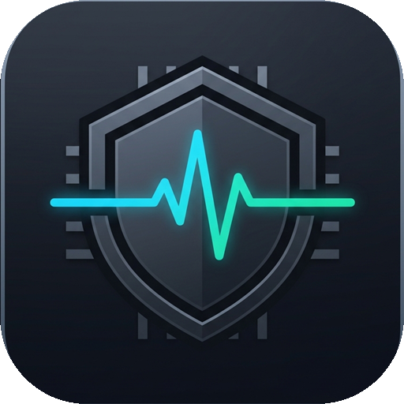

<p align="center">
  
</p>

<h1 align="center">GameStateAssistant</h1>

<p align="center">
  <strong>Windows 11 Intel / AMD 双平台游戏性能体检与 1% Low 帧调优助手</strong><br/>
  <sub>Created by <strong>chengnanyaowang</strong> · .NET 10 WPF Single-File · Zero Telemetry · MIT License</sub>
</p>

<p align="center">
  
  
  
  
</p>

---

**GameStateAssistant** 是一款面向 **竞技网游与 3A 大作玩家** 的轻量级、零依赖便携式系统体检与稳帧调优工具。默认只读体检、所有改动均经确认清单且支持原值 JSON 快照回滚，无后台常驻服务、无广告遥测。

## 核心特性

### 1. Intel / AMD 双平台自适应切换
标题栏内置 **`自动识别` / `Intel` / `AMD`** 三档实时切换，自动探测本机 CPU 型号、核数/线程数、内存通道数与频率、显卡显存及显示器刷新率：

| 优化维度 | Intel 大小核模式（12~14 代 / Core Ultra） | AMD 锐龙模式（Zen 4 / Zen 5 / 7500F / X3D） |
| :--- | :--- | :--- |
| **电源与调度** | 平衡计划保护 Intel Thread Director + P 核零休眠 | 平衡计划保护 CPPC / 3D V-Cache 调度 + 全核零休眠 |
| **平台底座检测** | Intel IPF / DTT 温控与功耗墙服务检测 | AMD 官方芯片组驱动 (`amdppm` / `amd3dvcacheSvc`) 检测 |
| **内存瓶颈预警** | 16GB~32GB 虚拟内存预分配 | **单通道 / 16GB 内存防爆红线提醒**（专治 PUBG 换页卡顿） |
| **语音/平台隔离** | 动态锁入纯后置 E 核 + `BelowNormal` | 动态锁入尾部逻辑线程（双 CCD X3D 自动避开 3D 缓存 CCD0） |

### 2. 竞技网游与 3A 大作专项调优
* **自适应刷新率 RTSS 锁帧矩阵**：自动按当前显示器刷新率计算 `RefreshRate - 3`（如 `260Hz→257`、`240Hz→237`、`165Hz→162`、`144Hz→141`），一键同步 PUBG / CS2 / 英雄联盟 / 无畏契约。
* **MSI Afterburner 传感器防冲突**：自动屏蔽 `-GPU1 power` 功耗轮询，消除每秒一次的微卡顿。
* **游戏专属模板**：PUBG 黄金竞技配置、CS2 低延迟音频与扫射防顿卡、英雄联盟防 DX11 调度蓝屏配置、3A 大作动态显存安全线（《赛博朋克 2077》《艾尔登法环》）。
* **Oopz & 完美世界竞技平台专属降占中心**：支持实时核心隔离、Oopz AI 降噪档位切换、主窗口最小化降渲染及反向游戏主核保护校验（绝不触碰反作弊内核，绝不传染游戏进程）。

### 3. 安全透明与完整回滚（借鉴 optimizerDuck 安全工程理念）
* **全项风险分级**：每条规则明确标注 **安全 / 谨慎 / 专家权衡** 与权限需求（免权限 / 需提权）。
* **默认只读 + 逐项确认**：启动仅做只读体检；所有后台关闭、缓存清理和系统/游戏修改必须经深色确认弹窗逐项勾选后执行；HVCI 内存完整性等安全功能永不参与一键批量修复。
* **完整 JSON 原值快照回滚**：首次修改系统项前自动记录电源计划、PCIe/USB 节能、GameDVR、内容推送、MMCSS 多线程调度及核心停驻原值至 `%LOCALAPPDATA%\GameStateAssistant\restore_v4.json`，支持一键还原；所有游戏配置修改前自动生成 `.bak` 时间戳备份。
* **内置精选安全低延迟项**：MMCSS 游戏多线程优先调度、PCIe ASPM & USB 选择性暂停关闭、Windows 静默推广推送精简（零破坏，不卸载系统商店或 Defender）。

## 构建说明

环境要求：Windows 10/11 x64 + [.NET 10 SDK](https://dotnet.microsoft.com/)

```powershell
# 构建轻量单文件版 (~400KB，需目标电脑安装 .NET 10 Desktop Runtime)
powershell -NoProfile -ExecutionPolicy Bypass -File .\build.ps1

# 构建免环境独立便携单文件版 (~62MB，内置运行库，任意 Win10/11 双击即开)
powershell -NoProfile -ExecutionPolicy Bypass -File .\build.ps1 -Portable
```

支持命令行无界面自检验证：

```powershell
.\GameStateAssistant.exe --verify
```

## 作者与协议

* **Author**: `chengnanyaowang`
* **License**: [MIT License](LICENSE)
